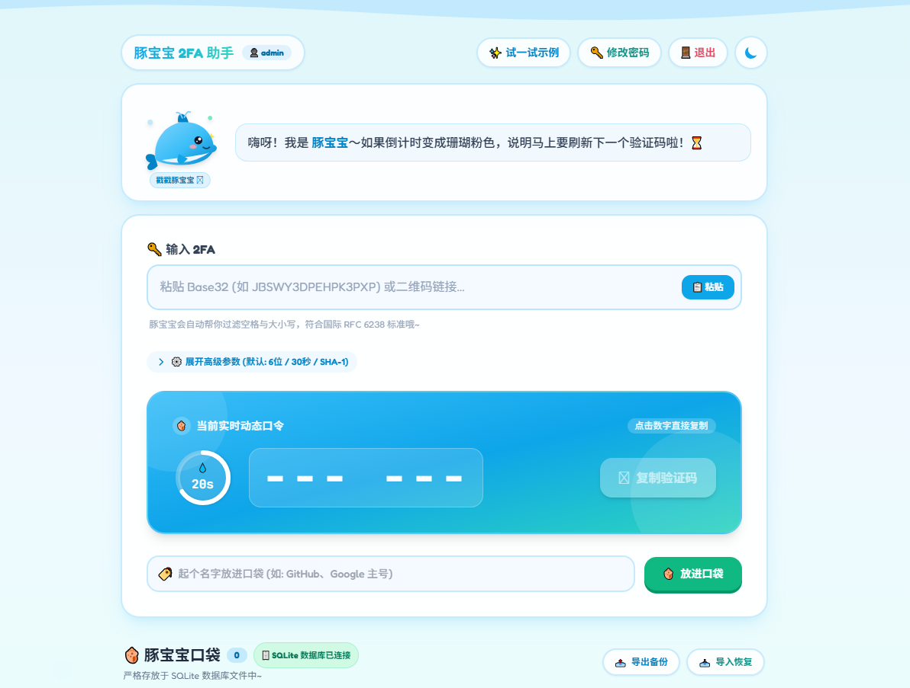
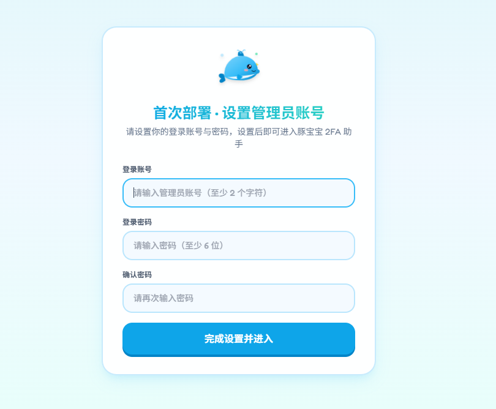
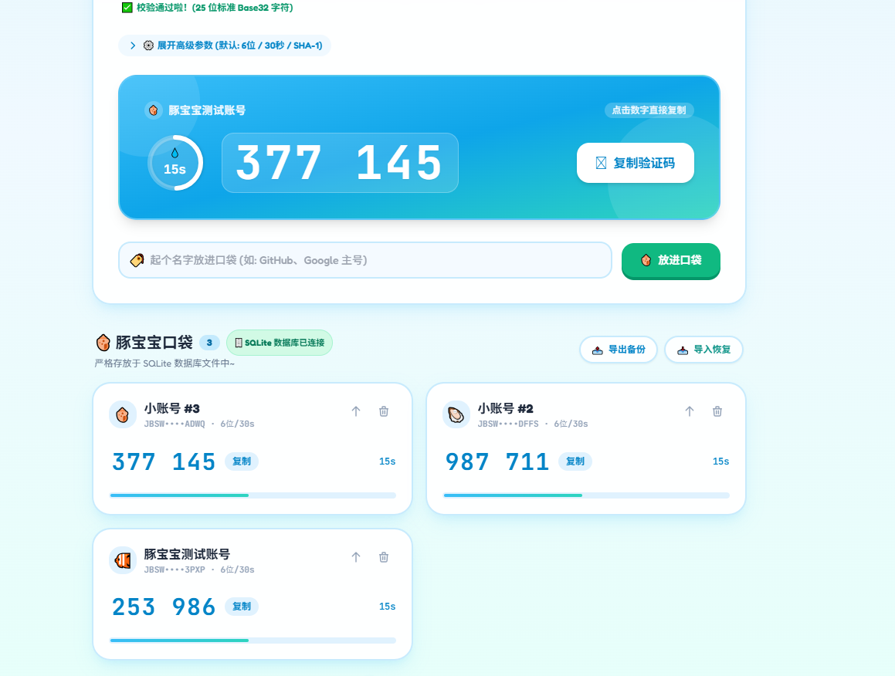
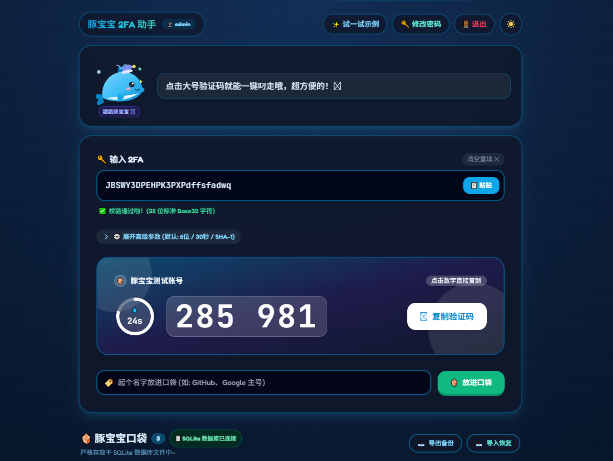

# 豚宝宝 2FA 助手 (Dolphin 2FA Assistant) v2.0

一个轻量、安全、高颜值的自托管离线 2FA（TOTP）动态口令验证器。采用 **Go 单文件二进制** + **纯 Go SQLite** + **静态资源内嵌（`go:embed`）** 架构，支持管理员登录、AES-256-GCM 数据库信封加密、IP 防暴力破解以及 Docker Compose + Nginx HTTPS 部署。

## 安全与稳定性特性

1. **IP 防暴力破解 + 防伪造头**：同一 IP 连续输错密码 5 次自动锁定 15 分钟并返回 `429`；默认仅信任直连 IP，配合 Nginx 反向代理时通过 `-trust-proxy` 开启真实 IP 与 HTTPS 协议识别。

2. **AES-256-GCM 数据库信封加密**：`tokens` 表中所有 2FA 密钥落盘全密文，登录后导出备份为明文 JSON。










## 推荐Docker部署

安装docker

```bash
curl -fsSL https://get.docker.com | sh
```

## 🔧 域名与 SSL 证书配置指南

在部署或迁移到新域名、更换新证书时，只需修改以下指定文件即可，**无需重新编译 Go 二进制文件**。

### 一、 如何更换域名

打开 **`nginx/default.conf`**，找到以下 **两处** `server_name`，将示例域名替换为你自己的实际域名（例如 `2fa.example.com`）：

1. **第 1 处（第 3 个 `server` 块：HTTP 80 端口自动跳转 HTTPS）**：

   ```
   # 3. 仅允许你的域名走 HTTP -> HTTPS 跳转
   server {
       listen 80;
       listen [::]:80;
       server_name 2fa.example.com;   # <--- 修改这里：填入你的域名
   
       return 301 https://$host$request_uri;
   }
   ```

2. **第 2 处（第 4 个 `server` 块：HTTPS 443 端口反向代理主体）**：

   ```
   # 4. 你的域名 HTTPS 反向代理
   server {
       listen 443 ssl;
       listen [::]:443 ssl;
       http2 on;
       server_name 2fa.example.com;   # <--- 修改这里：填入你的域名
   ```

> **⚠️ 重要提示**：`nginx/default.conf` 中前两个带有 `default_server` 的 `server` 块里的 `server_name _;` **请勿修改**！它们专门用来拦截所有非你域名的请求（包括直接用服务器 IP 访问），并返回自定义豚宝宝 `404` 页面。

### 二、 如何更换 SSL 证书路径与文件

1. **推荐先在本地编译好 Linux 二进制文件再打包镜像**（容器运行后实际内存占用仅约 `20MB`）：

   1. **在本地生成 Linux 二进制文件**：

      - Windows 用户直接运行 `build_linux.bat`（或执行以下命令）：

        ```
        $env:CGO_ENABLED="0"; $env:GOOS="linux"; $env:GOARCH="amd64"; go build -trimpath -ldflags="-s -w" -o dist/dolphin-2fa .
        ```

   2. **上传项目到服务器**：将整个项目文件夹（确保包含 `dist/dolphin-2fa`）上传至服务器（例如 `/root/dolphin-2fa`）。

   3. **修改域名与放置 SSL 证书**

   Docker 容器与宿主机之间的证书目录映射关系如下：

   ```
   宿主机目录: ./nginx/ssl/   <=== 挂载映射 ===>   Nginx 容器内目录: /etc/nginx/certs/
   ```

   根据你的实际使用场景， 配置证书：

   1. 将你申请到的域名证书文件放入项目根目录下的 **`nginx/ssl/`** 文件夹中，并重命名为默认文件名：

      - 证书链 / 公钥文件：`nginx/ssl/fullchain.cer`
      - 私钥文件：`nginx/ssl/private.key`

   2. 如果你的证书文件后缀是 `.pem` 或 `.crt`（例如 `fullchain.pem` 和 `privkey.pem`），不想重命名文件，也可以直接修改 **`nginx/default.conf`** 中 **两处** `ssl_certificate` 路径（注意：第 2 个默认兜底 `server` 块和第 4 个域名 `server` 块里各有一处，**两处必须保持一致**）：

      ```
      ssl_certificate     /etc/nginx/certs/fullchain.pem;   # 对应宿主机 nginx/ssl/fullchain.pem
      ssl_certificate_key /etc/nginx/certs/privkey.pem;     # 对应宿主机 nginx/ssl/privkey.pem
      ```

   3. **一键启动容器**：

      ```
      docker compose up -d
      ```

   4. **首次访问初始化**：

      - 浏览器打开 `https://你的域名`，首次进入会提示设置管理员账号与密码；
      - 尝试直接访问 `http://你的服务器IP` 或 `https://你的服务器IP`，Nginx 会自动拦截并展示豚宝宝主题 `404` 页面。

### 三、 修改域名或证书后使其生效

无论修改了域名还是替换了证书文件，执行以下命令重载 Nginx 即可（不会中断后端 2FA 服务）：

```
# 1. 先检查 Nginx 语法与证书路径是否正确（无报错再重载）
docker exec dolphin-2fa-nginx nginx -t

# 2. 若修改了 docker-compose.yaml 挂载路径，执行重建：
docker compose up -d --force-recreate nginx

# 3. 若仅替换了 nginx/ssl/ 下的证书文件内容或修改了 default.conf，直接平滑重载：
docker exec dolphin-2fa-nginx nginx -s reload
```

## ⚙️ 命令行参数说明

```
./dolphin-2fa [参数]
```

| **参数**       | **默认值**              | **说明**                                                     |
| -------------- | ----------------------- | ------------------------------------------------------------ |
| `-host`        | `127.0.0.1`             | HTTP 服务监听地址（Docker 容器内通常设为 `0.0.0.0`）         |
| `-port`        | `8080`                  | HTTP 服务监听端口                                            |
| `-db`          | `./data/dolphin_2fa.db` | SQLite 数据库文件存储路径                                    |
| `-no-browser`  | `false`                 | 启动时不自动打开本地浏览器（服务器部署建议开启）             |
| `-trust-proxy` | `false`                 | 是否信任反向代理传递的 `X-Real-IP` / `X-Forwarded-For` / `X-Forwarded-Proto` 请求头（**仅在 Nginx/Caddy 反代后且未直接暴露 8080 端口时开启**） |

## 🔧 常用运维命令

- **查看运行状态与实时日志**：

  ```
  docker compose ps
  docker compose logs -f
  ```

- **更新 Go 二进制文件后重启后端**：

  ```
  docker compose up -d --build dolphin-2fa
  ```

- **数据备份与迁移**：

  - **方式 1（推荐）**：登录 Web 界面，点击「📤 导出备份」下载标准明文 JSON 备份文件；
  - **方式 2**：直接定期备份宿主机上的 `data/dolphin_2fa.db` 文件。


## 豚宝宝 2FA（v1.0）停止更新

## 核心特性

1. **零外部依赖，离线秒编译**：后端仅依赖 Go 标准库 + `go:embed`，无需联网下载第三方包，编译体积更小、启动更快。
2. **纯内存实时计算**：不读写任何数据库文件，也不写入浏览器 `IndexedDB` 或 `localStorage`，关闭即清空。
3. **前后端源码分离**：开发时 `index.html`、`css/`、`js/`、`images/` 保持独立，编译时自动打包进单个 `dolphin-2fa.exe`。

## 构建 Windows EXE
双击运行 **`build_exe.bat`**，或在目录打开命令行执行：

1. Windows CMD（推荐）

   ```cmd
   set CGO_ENABLED=0&& set GOOS=linux&& set GOARCH=amd64&& go build -trimpath -ldflags="-s -w" -o dist\dolphin-2fa-linux-amd64 .
   ```

2. Windows PowerShell

```PowerShell
$env:CGO_ENABLED="0"; $env:GOOS="linux"; $env:GOARCH="amd64"; go build -trimpath -ldflags="-s -w" -o dist/dolphin-2fa-linux-amd64 .
```

3. Linux / macOS

4. ```bash
   CGO_ENABLED=0 GOOS=linux GOARCH=amd64 go build -trimpath -ldflags="-s -w" -o dist/dolphin-2fa-linux-amd64 .
   ```

## 命令行启动示例

```bash
# 默认启动（监听 127.0.0.1:8080，自动打开浏览器）
dolphin-2fa.exe

# 自定义端口
dolphin-2fa.exe -port 9000

# 启动时不自动打开浏览器
dolphin-2fa.exe -no-browser

# 监听所有网卡（允许外网/局域网访问）且不尝试打开浏览器
./dolphin-2fa-linux-amd64 -host 0.0.0.0 -port 8080 -no-browser
```

## 常见问题

**验证码显示错误**

Windows 上正常：你是通过本机 `[http://127.0.0.1:8080](http://127.0.0.1:8080)` 访问的，属于安全上下文。

Linux 上显示 `ERR`：你是通过 `http://服务器IP:8080` 访问的，非 HTTPS 的远程 IP 会被浏览器禁用 `window.crypto.subtle`，导致 `generateTOTP` 抛出异常并显示 `ERR`。   

由于`js/totp.js` 中使用了浏览器原生的 `window.crypto.subtle`（Web Crypto API）来计算 TOTP 验证码。现代浏览器规定，该接口**仅在 `https://` 或本机 `[http://127.0.0.1](http://127.0.0.1)` / `http://localhost` 下可用**。   

**解决办法**

给 Linux 站点加上 HTTPS，在 Linux 服务器上使用 **Nginx** 或 **Caddy** 做反向代理，将 `https://你的域名` 转发到本地的 `[http://127.0.0.1:8080](http://127.0.0.1:8080)`。

## 写在最后

v1.0版本没有数据库，适用于在线验证2FA

V2.0 一次全新大改变

本项目基于 [MIT License](https://gemini.google.com/app/LICENSE) 开源。
